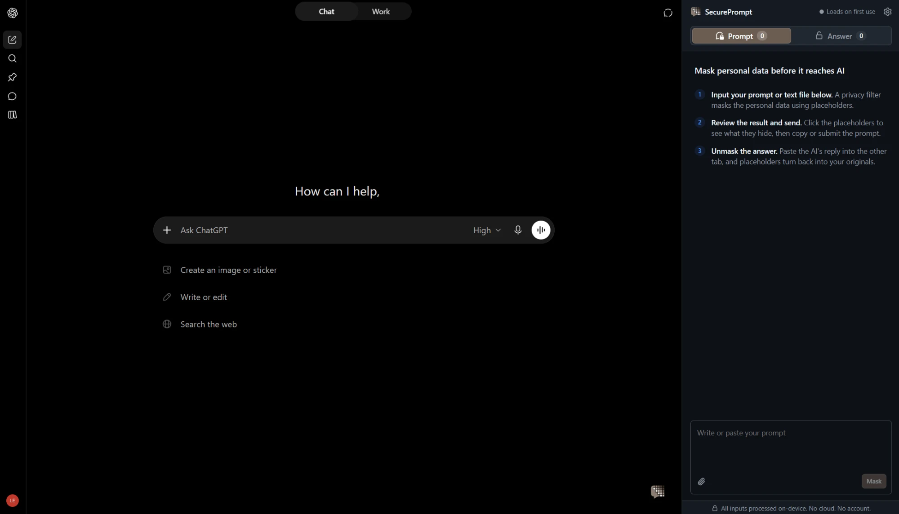
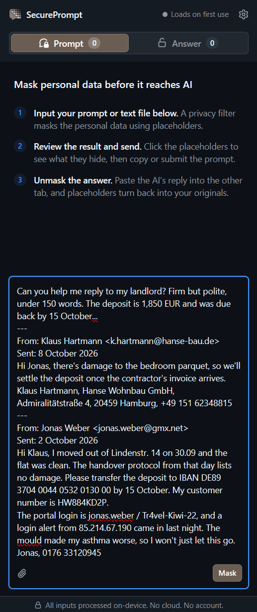
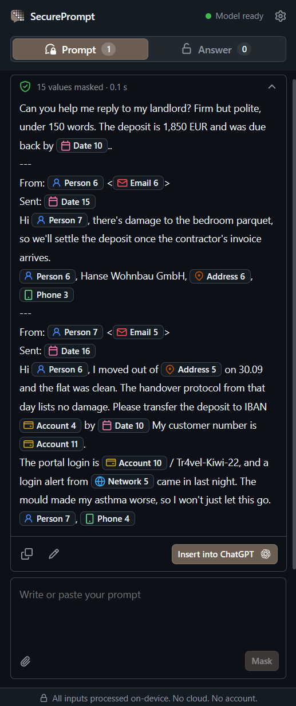
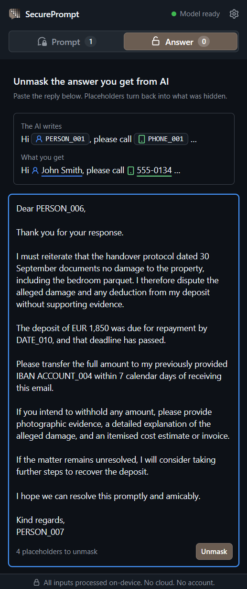
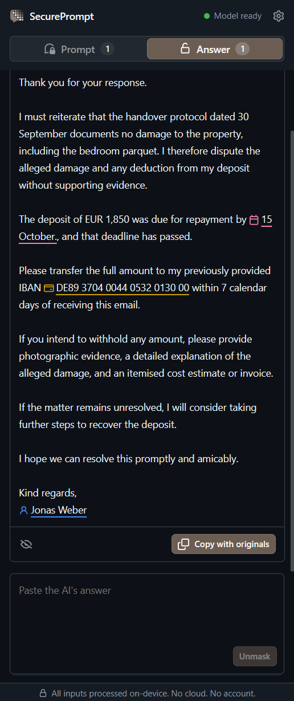
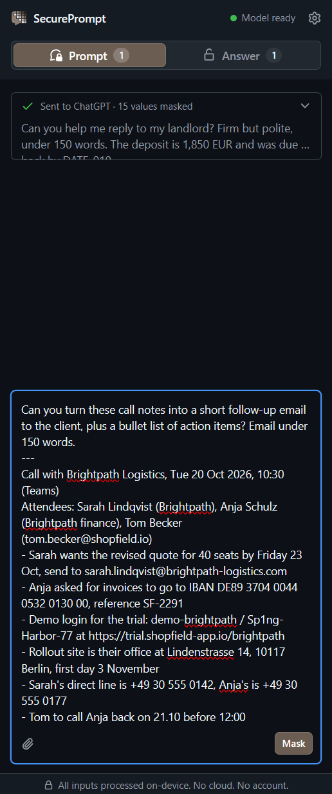
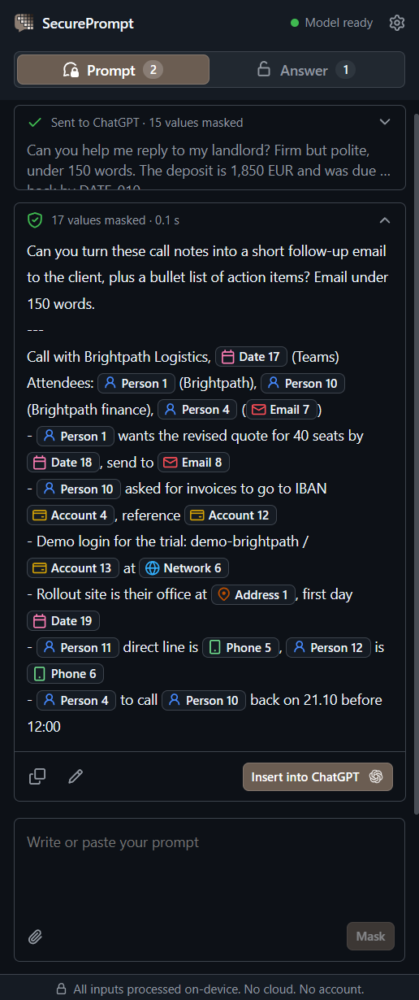
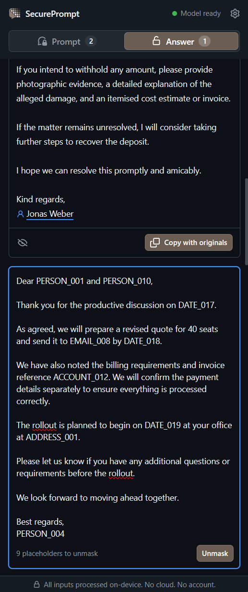
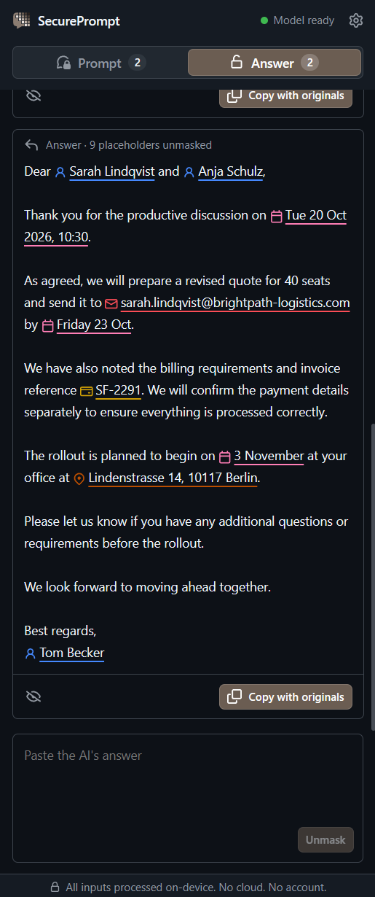

<p align="center">
  
</p>

<h1 align="center">SecurePrompt</h1>

<p align="center">
  Hides personal data in your AI prompts before you send them away.<br>
  Detection runs on your device. No accounts. No cloud.
</p>

<p align="center">
  
  
  
</p>

## Features

SecurePrompt runs in a Chromium browser side panel next to your AI chat tab. It replaces personal data in your prompt with placeholders, then turns them back into your originals in the answer.



### Supported chat sites

- **ChatGPT:** [chatgpt.com](https://chatgpt.com) and [chat.openai.com](https://chat.openai.com)
- **Claude:** [claude.ai](https://claude.ai)
- **Gemini:** [gemini.google.com](https://gemini.google.com)
- **Mistral:** [chat.mistral.ai](https://chat.mistral.ai)
- **Perplexity:** [perplexity.ai](https://www.perplexity.ai)
- **Grok:** [grok.com](https://grok.com)

### Walkthrough

Example A: Landlord disputes a deposit

<table>
  <tr>
    <th>1. Insert your prompt</th>
    <th>2. Review the masks</th>
    <th>3. Paste the AI's answer</th>
    <th>4. Restore your originals</th>
  </tr>
  <tr>
    <td></td>
    <td></td>
    <td></td>
    <td></td>
  </tr>
</table>

Example B: Sales call follow-up

<table>
  <tr>
    <th>1. Insert your prompt</th>
    <th>2. Review the masks</th>
    <th>3. Paste the AI's answer</th>
    <th>4. Restore your originals</th>
  </tr>
  <tr>
    <td></td>
    <td></td>
    <td></td>
    <td></td>
  </tr>
</table>

### Detection

Two detectors run on every prompt, and their results are merged:

- **The rules:** Handle formats with a formal definition. IBANs and payment cards are checked with their checksums, URLs, IP and MAC addresses are parsed, and JWTs, private keys and provider tokens are matched by their fixed formats.
- **The model:** PII detection model [bardsai/eu-pii-anonimization-multilang-v2](https://huggingface.co/bardsai/eu-pii-anonimization-multilang-v2) handles context-dependent items such as names, addresses and ambiguous IDs, in 24 EU languages. It runs fully locally on your device via the browser.
- **Overlaps:** When detections overlap, the masked area covers both to reduce leaks.

### Masking

Sensitive values become typed placeholders such as `PERSON_001`, `EMAIL_042`, or `PHONE_067`. The AI still sees the structure of your text and can answer about it, but not the original values.

- **Same value, same placeholder:** Repeat mentions of a person get the same `PERSON_001`, including a first or last name on its own, so the AI can tell who is who. A name two people share gets its own placeholder. Usernames built from a name, like `jane.sim`, get an `ACCOUNT` placeholder.
- **Masked categories:** Names, email addresses, phone numbers, postal addresses, account and card numbers, specific dates and deadlines, network addresses, and secrets in known formats such as API keys.
- **Left readable:** Titles and roles ("Dr."), vague dates ("in March", "1990"), bare times ("14:00"), and company names.

### Review before sending

Click a placeholder to see what it hides. Copy the masked text, or insert it into the chat page of a supported site. You can also load a text file instead of typing.

### Restore in answers

Paste the AI's answer into the answer tab and the placeholders turn back into your original values. "Copy with originals" gives you the finished text.

## Install

Requires Node.js 24 and pnpm 11:

```sh
pnpm install
```

```sh
pnpm build
```

In a Chromium browser, open `chrome://extensions`, turn on **Developer mode**, choose **Load unpacked**, and select `apps/extension/.output/chrome-mv3` to add the extension.

The side panel asks for permission to download the model from Hugging Face (about 340 MB). Until the model is ready, nothing is masked.

## Testing

| Command                     | Purpose                                           |
| --------------------------- | ------------------------------------------------- |
| `pnpm typecheck`            | TypeScript checks for every package and the tests |
| `pnpm format:check`         | Prettier checks for JSON, Markdown, YAML and CSS  |
| `pnpm test`                 | Unit and integration tests                        |
| `pnpm test:coverage`        | Same tests with coverage reports                  |
| `pnpm test:package`         | Builds the extension and checks its manifest      |
| `pnpm test:install-browser` | Installs the browser for browser tests (run once) |
| `pnpm test:browser`         | Playwright tests against the built extension      |

## Privacy

- Raw prompts, original values and mappings never leave the device and are never written to disk.
- Mappings live in memory. `chrome.storage.session` keeps them until the browser closes, so answers can be restored after the side panel is closed.
- No telemetry, analytics or remote detection APIs.
- Host permissions only for the supported chat sites, plus the model's download host as an optional permission.
- Only masked text can reach a chat page. If the model can't run, nothing is masked or inserted, and there is no fallback to raw text.
- End-to-end tests enter made-up personal data and check that it is never sent over the network.

## Limitations

- Detection will miss some personal data, such as passwords in running text. Always read the masked text before you send it.
- Restoring the originals only works if the AI keeps placeholders exactly as written.

## License

SecurePrompt is released under the [MIT License](LICENSE). The third-party software it includes keeps its own licenses, listed in [THIRD_PARTY_NOTICES.txt](apps/extension/public/THIRD_PARTY_NOTICES.txt). That file is also packaged inside the extension. The detection model is not included. It is downloaded from [Hugging Face](https://huggingface.co/bardsai/eu-pii-anonimization-multilang-v2) on first use and is licensed under the Apache License 2.0, as stated on its model card.
